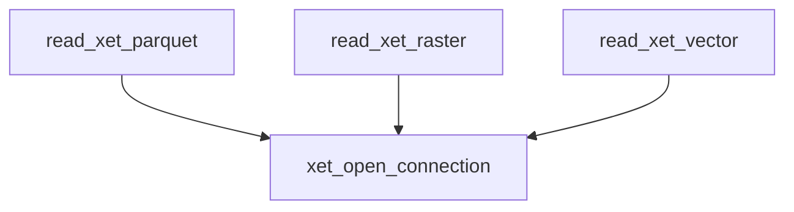
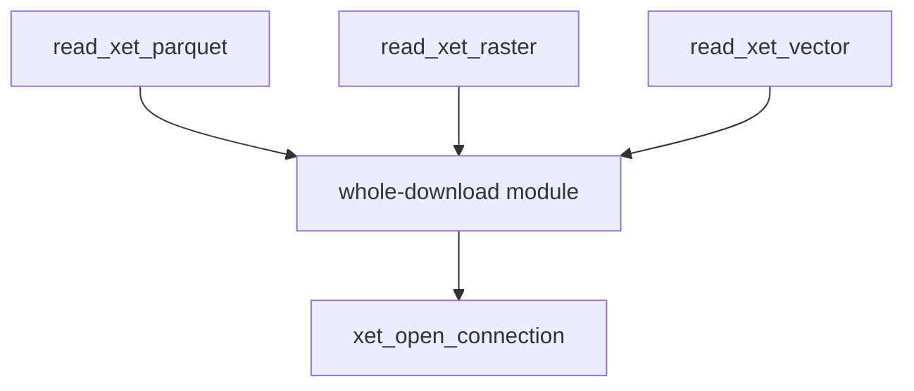

# rxet architecture review

Scope: R wrapper layer (`R/`) and Rust bindings (`src/rust/src/lib.rs`). No `GLOSSARY.md` exists. ADRs 0001-0004 in `docs/decisions/` were read. Hot spots from git log: spatial/arrow/connection helpers and client config.

Vocabulary: **module**, **interface**, **depth**, **seam**, **leverage**, **locality** (see the codebase-design skill).

## 1. Whole-download reader module (arrow / raster / vector) - Strong

**Files:** `R/arrow.R`, `R/spatial.R`, `R/connection.R`

**Problem:** `read_xet_parquet`, `read_xet_raster` and `read_xet_vector` each repeat the optional-package check, the three-line argument validation, connection open/close handling and (raster, vector) the `readBin` -> tempfile -> `unlink` sequence. Each is a shallow module: its interface is nearly all of its implementation. Close-on-error rules differ (arrow closes the connection itself; the others use `on.exit`), so lifecycle knowledge is scattered. Deletion test: removing one helper moves the same logic into its siblings, while a shared module would concentrate it.

**Solution:** One internal whole-download module that owns the connection lifecycle, the size cap and the temp-file lifetime, and takes the format reader as the only varying part. The three exports become thin readers.

**Benefits:** Locality: the connection and temp-file lifecycle (leaks, cleanup, token safety) is fixed once. Leverage: a new format helper is a few lines. Tests: one set of lifecycle tests through the module's interface; format tests cover only what the reader does.

Before:

After:

## 2. Request validation module (handle, hash, size, range) - Strong

**Files:** `R/download.R`, `R/stream.R`, `R/connection.R`, `R/upload.R`, `R/arrow.R`, `R/spatial.R`, `R/client.R`

**Problem:** The same handle/hash/size `stopifnot` lines appear about 7 times and the rules have drifted:

- size must be `>= 0` in download, stream and connection but `> 0` in the three readers;
- the whole-number check is copied in three files;
- the 2 GiB cap is hand-written in two files with different messages;
- Rust has two near-duplicate converters, `to_whole_bytes` and `whole_u64`.

The rules have no single home, so a fix lands in one place and the bug survives in another.

**Solution:** An internal validation module that owns "what a valid Xet file reference and byte range is", including the 2 GiB in-memory cap. Public functions call it once. On the Rust side, merge the two whole-number converters.

**Benefits:** Locality: size and range invariants live in one place. Leverage: every entry point gets the same rules. Tests: boundary cases (0, fractional, cap, end > size) are tested once through one interface.

## 3. Rust `lib.rs`: client, transfer and registry in one file - Worth exploring

**Files:** `src/rust/src/lib.rs` (418 lines), `registry.rs`, `tests.rs`

**Problem:** `xet_stream_raw`, `xet_stream_range` and `xet_download_file` each acquire the client, build auth and map size-mismatch errors. The error-text parsing (`number_after`, `size_mismatch_message`) sits in the extendr binding file, and `tests.rs` reaches it through helpers rather than a transfer interface.

**Solution:** Move the transfer logic (auth, size-mismatch mapping, safe execution) into a module separate from the extendr shims.

**Benefits:** Locality for error mapping; tests cross the transfer interface. Smaller gain since the Rust is already compact.

## 4. Handle as a first-class object - Speculative

**Files:** `R/client.R` and every function taking `handle`

**Problem:** Every function takes a bare character handle and re-validates it; a closed or invented handle is only caught in Rust.

**Solution:** A classed client object validated once at construction.

> **Warning:** contradicts the AGENTS.md design choice (opaque UUID strings) and the public API recorded in ADR 0001/0004. Reopen only if handle misuse is a real source of bugs.

## Top recommendation

Start with **#2 (validation module)**: smallest change, fixes real drift (`> 0` vs `>= 0`, duplicated 2 GiB cap), and gives #1 one place to call for its checks.

**Decision (2026-10-22, user):** start with #1, the whole-download reader module. Plan a wave-orchestration run that also resolves the request validation issues (#2).
