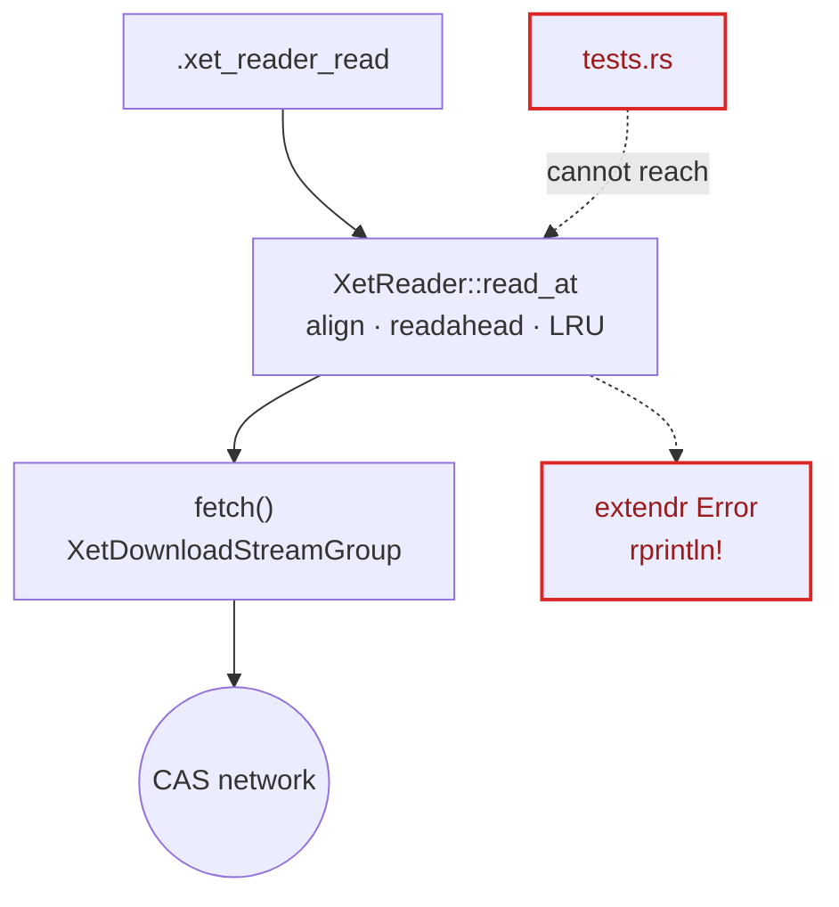

# rxet architecture review (2026-11-05)

Branch: v030
Source: `architecture-review-20261105-063946.html` (converted to Markdown)

Scope: the hot spots of the last ~15 commits. These are the lazy range read path (`R/stream_connection.R`, `src/connection.c`, the reader cache in `src/rust/src/lib.rs`), the stream functions, and the whole-download and validation modules. Settled by ADRs 0001–0006, so not re-argued here.

Legend: **module** (box), **seam** (dashed line), **leakage** (red), **deep module** (dark block).

## Status check (added during conversion)

Checked against the tree on 2026-11-06. The review predates some work.

- **Candidate 1 is largely shipped.** `src/rust/src/reader.rs` exists and defines `RangeSource` (`pub(crate) trait`, line 20). `XetStreamSource` implements it in `lib.rs`, and `tests.rs` has a `MemorySource` that logs each fetch. Commits `8e3c3ba`, `3a63a86`, `053d96f`, `3c50efb`, `6280ec0` and `0af47f8` cover the work. The review's "has no tests" claim is stale.
- **Candidates 2 to 5 still stand** as described, but line numbers have moved. Re-check them before planning.

### Update 2026-11-09

- **Candidate 2 is shipped** (commits `ffebca3`, `f98b732`, `37279bf`, `8a10f3b`; ADR 0007 amends ADR 0006 decision 4). The reader owns the file size and `close(conn)` releases the reader at once. The offline closure tests are in place. Tracked as G2, now pruned.
- **Candidate 3 is next**, now unblocked. Tracked as G3, the circled goal.
- **Candidate 4:** the range rule is decided (R rule kept, 2026-11-07). The transfer-module duplication is still open. Tracked as G4.
- **Candidate 5** is deferred until G3 merges, per G5's trigger.

---

## Candidates

### 1 · Put the reader window policy behind a fetch seam — Strong, ports & adapters

Files:
- `src/rust/src/lib.rs:20-151` (ReaderCache, XetReader::read_at, fetch)
- `src/rust/src/tests.rs`

Before:

After: the reader window policy (64 KiB alignment, readahead doubling, 64 MiB eviction) sits in a deep module with the interface `read_at(offset, len)`. It calls `fetch(start, end) → bytes` through a seam. Two adapters sit behind the seam:
- `XetDownloadStreamGroup` (production)
- in-memory bytes plus a fetch log (tests)

**Problem.** The cache policy (alignment, readahead growth, reset on seek, eviction, short-body errors) is fused to the network fetch and to extendr's error type. It has no tests, and reaching it needs `local_cas_server`.

**Solution.** Give the window policy a pure-Rust interface that takes a `fetch(start, end)`. `XetReader` becomes the stream-group adapter, and tests pass an in-memory adapter that records every range.

- Two adapters: the seam is real
- Tests assert fetch ranges and counts
- Locality: the cache policy lives in one module
- extendr types leave the cache module
- ADR 0006 numbers become executable

### 2 · One owner for the stream connection's lifetime and size — Worth exploring, in-process

Files:
- `R/stream_connection.R:45-68`
- `src/connection.c:20-131`
- `src/rust/src/lib.rs:154-230` (extern, open/read/close_reader, xet_stream_connection)
- `src/rust/src/registry.rs`

Before: one read crosses three languages.
1. C `rxet_conn_read` (size #1)
2. R closure → `.Call`
3. Rust registry lookup by UUID
4. `XetReader::read_at` (size #2)
5. Close: C releases the closure → GC → R finalizer → Rust

After:
1. C connection: `read(offset, n)` closure only
2. Seam (already exists as `.xet_stream_connection(read_fun, size)`)
3. Stream connection module: opens the reader, owns the file size, and closes the reader when the connection is destroyed

The closure seam already exists. Tests can drive it with a closure over local bytes.

**Problem.** Reader lifetime is spread across C, R and Rust. File size is passed in twice and kept in two places. Closing the connection does not free the stream group until a GC runs, despite what the comment says.

**Solution.** Make one module own open, size and close, so the reader is released when the connection is destroyed. Test the C connection offline through its existing closure seam.

- File size stored once
- Close releases the reader at once
- C connection tested without a server
- Locality: lifetime bugs in one place

> Touches ADR 0006 decision 4 (lifetime bound by a finalizer on a captured env). Reopen only if the GC-delayed release matters in practice. The offline closure tests do not conflict with it.

### 3 · Collapse the two connection constructors — Worth exploring, in-process

Files:
- `R/connection.R` (`xet_open_connection`)
- `R/stream_connection.R` (`xet_open_stream_connection`)
- `R/stream.R:15`, `R/arrow.R:53`, `README.md`, `tests/testthat/test-whole-download.R:63-77`

Before: two interfaces with the same signature.
- `xet_open_connection`: 46 lines of docs, 3 checks, backed by `rawConnection(stream_raw)`
- `xet_open_stream_connection`: same args, R ≥ 4.3, backed by a lazy reader

After: one connection constructor. It is lazy where R allows (R ≥ 4.3) and falls back to `rawConnection` on older R.

**Problem.** `xet_open_connection` fails the deletion test: users could write the same thing in one line of base R. Nothing in `R/` calls it any more, yet docs still point readers to it ahead of the lazy path.

**Solution.** Keep one exported connection constructor that is lazy where R allows and falls back to the in-memory connection otherwise. Alternatively, drop the eager one and document the fallback.

- Interface shrinks by one export
- Docs stop pointing at the weaker path
- Delete a dead mock test

> Changes the export set fixed by ADR 0001/0004. That is a breaking change and needs a new ADR, but the function is Experimental-tier, so the cost is low.

### 4 · One Rust transfer module: group build plus byte-range pump — Worth exploring, in-process

Files:
- `src/rust/src/lib.rs:167-174, 398-436, 441-500, 550-557` (group builder ×4; `stream_raw` ≈ `stream_range`)
- `R/validate.R:36-53` vs `lib.rs:453-467` (range rule disagrees on end == start)

Before: `xet_stream_raw`, `xet_stream_range`, `xet_open_reader` and `xet_download_file` each build their own group; `fill_raw` pumps data for both stream functions. `validate.R` rejects `end == start`, which the Rust side does not share.

After: `xet_stream_raw`, `xet_stream_range`, `xet_open_reader` and `xet_download_file` all call one transfer module with `group(client)` and `stream_into(range?)`.

**Problem.** The download group builder chain is copied four times, `stream_raw` is `stream_range(0, size)` written out a second time, and the R and Rust range rules disagree on an empty range.

**Solution.** Use one internal Rust module that builds a group from a client and pumps an optional range into an R raw vector. Decide the empty-range rule once.

- Locality: auth/config chain in one place
- About 40 lines of duplicated pump gone
- One range rule, one error wording

### 5 · Split the whole-download module's `via` switch — Speculative, in-process

Files:
- `R/whole_download.R`, `R/arrow.R`, `R/spatial.R`

Before: `.rxet_whole_download(via=)` has two branches.
- `"stream"`: lazy ranges, which is not a whole download
- `"file"`: temp file, then reader(path)

Each branch validates again.

After: two honestly named helpers.
- With a stream connection: parquet
- With a temp file: terra, sf

**Problem.** The module's name and AGENTS.md say "whole download", but parquet now goes through the lazy path. The two branches share nothing beyond validation that runs twice.

**Solution.** Use two honestly named helpers, or inline the stream branch into `read_xet_parquet`.

- Names match behaviour
- Validation runs once

---

## Top recommendation

Put the reader window policy behind a fetch seam. *(Status: largely shipped. See the status check above.)*

The review rated it the newest and most intricate logic in the package (ADR 0006), with zero tests, and every byte `read_xet_parquet()` moves passes through it. One seam with two real adapters turns that policy into something `cargo test` checks offline.
